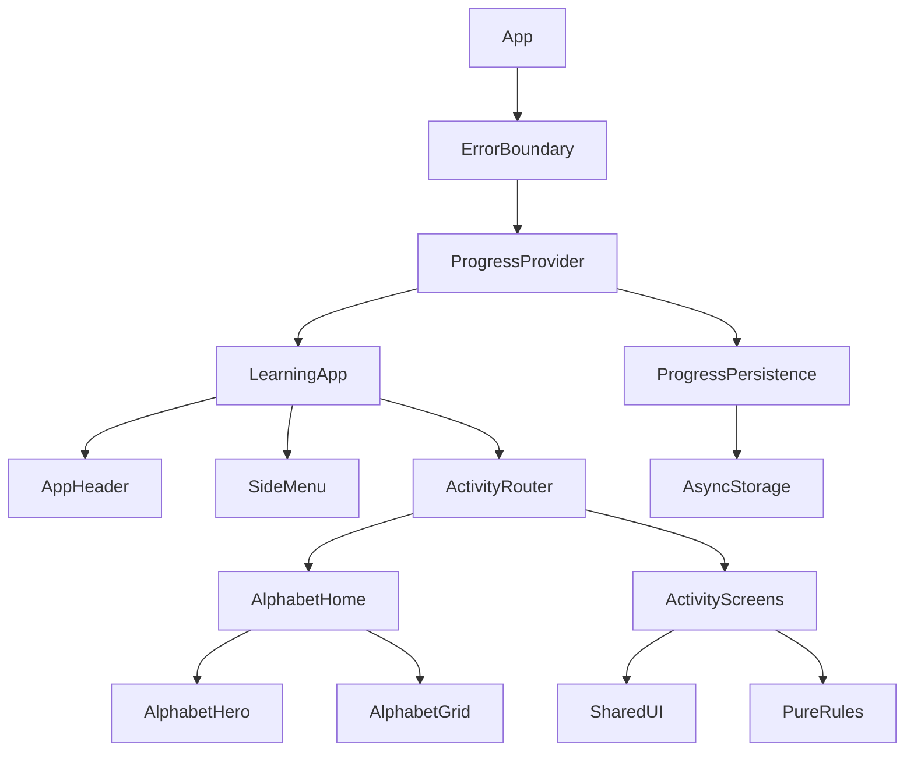

# Architecture

The app uses local React state for activities, a small screen router, and a shared progress context. There is no application backend, login, analytics service, or cloud synchronization.

## Component boundaries

- **App shell:** `App.tsx` manages screen selection and Android hardware-back behavior. Modal back behavior is handled by each modal's `onRequestClose`.
- **Presentational components:** shared buttons, toolbars, answer tiles, progress displays, and modals receive explicit props. They do not award points or read storage.
- **Interactive components:** the draggable animal owns its drag offset and responder. The tracing canvas draws scaled coordinates and forwards touches; the activity owns tracing completion.
- **Activity controllers:** screens own questions, hints, correctness, completion, and rewards. `useAutoAdvance` gives completed rounds a short celebration and cancels pending advancement on unmount.
- **Pure rules:** content selection, tracing recognition, hit testing, and progress reducers can be tested without React or a device.

## Progress lifecycle

1. `ProgressProvider` loads `@kids-abc/progress/v1` before mounting activities.
2. `readProgress` checks the format, sanitizes counters/IDs, and supplies missing fields for older saves.
3. A read failure shows a retry screen and blocks activity writes. Existing unread data is not silently overwritten.
4. Correct answers/tracings update the in-memory progress synchronously. Refs prevent duplicate rewards during rapid taps.
5. `createProgressPersistence` queues writes in order. A rejected write is reported to the caller and does not block later retries.
6. Write errors remain visible in the activities/sticker book. Retry saves the latest in-memory state.

Data stays on the device and is not a cross-device backup. A process killed before a pending write finishes can lose that last reward. Clearing app data or uninstalling removes local progress; Android backup behavior is platform-dependent and is not promised by this app.

## Content and tracing

Tracing uses a 300 × 300 coordinate system, converted to screen size together with finger positions. Outlines are sampled into points; recognition accepts nearby points in order. Stroke order is guided, lifting is allowed, and small facial details can fit within the forgiving touch radius. Animal outlines are simplified drawings rather than anatomy lessons.

Animal artwork is bundled in a single atlas. `AnimalArt.tsx` contains its cell order and intrinsic dimensions. Most animations are 2D motion of illustrations and shapes, not skeletal or interactive 3D animation.

## Extension rules

Keep content separate from activity state. Prefer a shared component when two screens need the same behavior. Keep timing/storage logic outside presentation components. Add a unit test for changed business rules and an integration test for changed user flows. Avoid adding a new state-management or navigation dependency for a single screen.

## Additional learning modules

`screens/` contains recorded audio exploration, introductory phonics, counting, color/shape matching, and progress backup. `data/learningCatalog.ts` supplies validated targets. `countingLogic.ts` prevents duplicate counting; `learningMatchLogic.ts` prevents duplicate target matches. `progressLogic.ts` adds fields without resetting version-1 rewards. Lowercase paths live beside uppercase/animal paths in `traceCatalog.ts`.

`audio/AudioController.ts` serializes ownership of native/web recorded audio and device speech. `audio/speech.ts` is the facade used by all activities. Sources and licenses are in the bundled asset manifest. `AnimalArt.tsx` uses a four-column/eight-row pose atlas for animated scenes.

`backupLogic.ts` validates before preview. `backupFiles.ts` uses native file/share APIs; `.web.ts` uses local upload/download. `ProgressProvider.restoreProgress` persists before replacing memory, and blocks navigation while restoring. See the dedicated backup guide for limits.

## Flying toys

`SkyPlay` composes `FlyingToy`, `SkyArt`, and `PopBurst`. `skyPlayLogic` defines responsive lanes and letter cycling; `useFlyingMotion` retains positions when paused and cleans up native animations. Navigation unmounts the session and clears timers/audio. Balloon/kite counts are temporary feedback and do not change persisted progress. Original bundled effects use the shared audio controller alongside recordings.

`useReducedMotion` subscribes to device accessibility changes and guards stale/unmounted reads. Sky play defaults to a slower pace; `flightDuration` defines both speeds. Reduced motion stops flying and confetti while keeping targets tappable. Start again remounts toys to clear pending celebrations and resets session counts without changing mode, mute, pause, speed, or saved rewards.

## Larger alphabet animal scenes

`LetterScene` routes eight animal letters to `components/alphabet/AnimalLetterScene`; object scenes retain their existing actions. `data/animalMotion` defines per-species pose orders, rest frames, loop durations, and bounded movement. `AnimatedAnimal` reuses the existing four-pose atlas without stretching the artwork. `useAnimationEnabled` gates animations with AppState and the device reduced-motion preference. Intervals, timelines, and subscriptions clean up on unmount. Alphabet hero/card springs also respect that gate.

## Animal sound matching

`AnimalSounds` composes shared toolbar, feedback, and `AnimalChoiceCard`. `useAnimalSoundGame` owns audio, question state, immediate answer locks, and automatic advancement; `animalSoundLogic` supplies four unique questions from five recorded species and shuffled choices. App backgrounding stops audio and pauses celebration timers. Correct answers use existing matching rewards, so old saves and backups require no schema change. Completing four questions counts as one matching adventure.

## Memory, eggs, and coloring

`memoryLogic` supplies balanced decks and guarded flips. `MemoryPairs` uses a synchronous state ref to prevent duplicate rewards; previews restart on deck changes, mismatches close after a gentle delay, and timers pause in the background. Matching pairs use existing matching stars/stickers.

`eggLogic` supplies eight shuffled animal letters and a bounded three-tap reveal. `SurpriseEggs` immediately guards reveal/next actions and saves one letter-adventure star per animal; the eighth reveal completes one adventure. Shared `useActivityAudio` plays known bundled recordings and optionally uses the device English voice for new memory animal names; playback stops on background/exit/reset.

`coloringLogic` normalizes input and interpolates fast finger movement with a 1,000-dot cap per picture. `useColoring` holds per-animal session drafts and undo history. `PaintCanvas` paints below reusable animal outlines; `ColoringAnimals` exposes named palettes and brushes. Clear is reversible. Pictures are not stored across navigation or included in progress backups; creative play does not alter rewards.

## Online memory expansion

`data/memoryPhotos.json` is a curated catalogue of 32 fixed Wikimedia Commons photo URLs, authors, source pages and licenses. `memoryAnimals` defines groups; `memoryLogic` matches by stable species IDs rather than initial letters. Runtime performs no searches or metadata discovery. `useMemoryPhotos` loads at most four unique photos per board, waits for readiness before preview timing, bounds failed loads to ten seconds, ignores stale responses after leaving/changing boards, and supports explicit retry. Shared statuses give both copies the same fallback when a photo fails.

`addMemoryReward` awards stars for every valid species and only awards one of the eight existing stickers for its actual original animal. New animals sharing an initial do not award an unrelated sticker. Progress format and backup validation remain unchanged. Photo credits are available in the activity. No photos are bundled in the APK; OS image caching may retain recently viewed pictures.

## Paint Studio architecture

The standalone paint document has version 1, a background color and ordered marks (brush, pencil, eraser, line, rectangle or oval). Fill targets the topmost rectangle/oval or the page; it does not flood arbitrary closed freehand regions. `react-native-svg` 15.16.0, the Expo SDK 58-supported version, renders the same geometry as exported SVG. Erasers render using the current background, so erased areas follow later page-color changes. Tap gestures create dots or 24-unit shapes as alternatives to dragging.

`studioLogic` validates local input, enforces at most 200 marks / 1,800 points, and bounds undo/redo to 30 document states. Only completed actions save. `studioPersistence` uses the separate `kids-abc-paint-studio-v1` key, serializes writes across activity mounts and waits for pending writes before reads. Failed/invalid reads never trigger writes. Failed saves keep the current drawing visible and offer retry. Undo history is session-only; the latest document persists. Learning progress and animal-coloring session drafts are independent.

Native PNG export captures the SVG at 1200 × 1200 using `toDataURL`; web PNG export rasterizes validated SVG in a local canvas. Native exports await file writes before opening system sharing. SVG export contains validated geometry only, with no external images or executable content. No new photo/storage permission is needed for cache files plus the share sheet. Existing native progress-backup export also awaits its write before sharing.

## Activity discovery and picture puzzles

`data/activities.ts` is the pure route catalogue, re-exported by SideMenu for compatibility. `activityGuide` exhaustively describes every destination except the guide itself. `PlayAndLearn`, `ActivityGuideCard` and `ActivityIntroModal` reuse shared buttons/toolbars. Suggestions exclude online-photo and adult tools and avoid immediate repeats. Full introduction narration uses `Audio.narrate` through `useActivityAudio`, sharing cancellation, mute, unmount and background cleanup with other playback. Narration requires the device English TTS voice.

`puzzleLogic` owns pure selection/placement and rectangular picture slicing. `PuzzlePieceArt` clips the existing bundled atlas; no image downloads are needed. `useAnimalPuzzle` owns three-picture lessons, a synchronous placement ref preventing duplicate rewards, audio and cancellable automatic progression. `puzzleLevels` and `PuzzleParts` define 2, 4, 6, 9, 12, 16, 25 and 36 pieces. `puzzleGrid` supplies rectangular/square layouts to all artwork and target calculations. Six pieces per tray page bound rendering; page state resets on lesson generation changes. Larger board sizing preserves touch targets in supported layouts. Two-piece halves remain the default. Each picture uses existing `recordAnswer(..., "matching", lastPicture)` so stars/stickers and backup schema remain compatible.

`DraggablePuzzlePiece` handles movement and reduced-motion snapping. `AnimalPuzzles` measures drop targets in window coordinates, with a tap alternative. Asynchronous drop measurement checks both mount state and lesson generation to reject stale drops after reset/advance. A whole-picture hint and spatial labels supplement the ghost image.

## Natural animal calls and pose blending

`data/animalSounds.ts` is the shared verified species/clip catalogue for alphabet playback, call-only replay, audio library and sound matching. `clipSelection` appends only the correct available species recording after the letter and example word. `newSoundLesson` chooses four unique targets from five calls with one distractor per round; existing matching rewards and storage format are unchanged. All call assets use the single audio controller and reduced animal playback volume.

`AnimalMotionSprite` owns the pose timer and short native opacity blend between adjacent atlas frames; `AnimatedAnimal` retains body paths and adds 1.2% breathing. The shared animation-enabled hook gates both; cleanup cancels timers and blend/body animations. No atlas downloads or new image assets are required.
