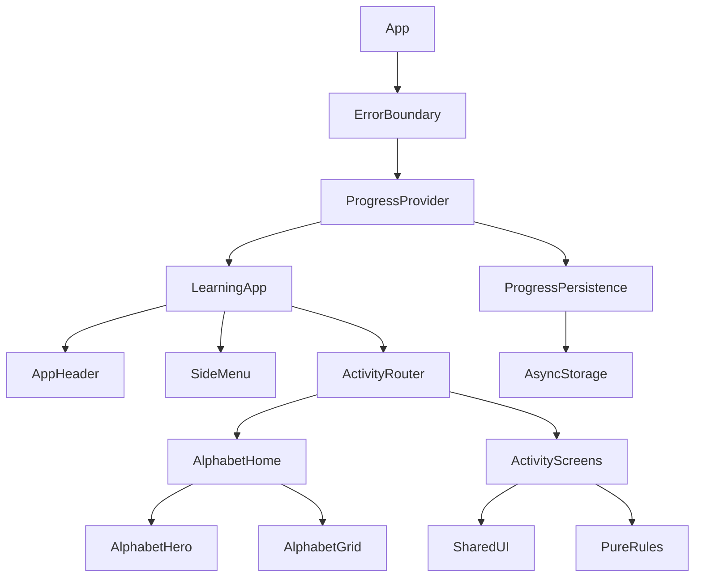

# Architecture

The app uses local React state for activities, a small screen router, and a shared progress context. There is no application backend, login, analytics service, or cloud synchronization.

## Component boundaries

- **App shell:** `App.tsx` manages screen selection and Android hardware-back behavior. Modal back behavior is handled by each modal's `onRequestClose`.
- **Presentational components:** shared buttons, toolbars, answer tiles, progress displays, and modals receive explicit props. They do not award points or read storage.
- **Interactive components:** the draggable animal owns its drag offset and responder. The tracing canvas draws scaled coordinates and forwards touches; the activity owns tracing completion.
- **Activity controllers:** screens own questions, hints, correctness, completion, and rewards. `useAutoAdvance` gives completed rounds a short celebration and cancels pending advancement on unmount.
- **Pure rules:** content selection, tracing recognition, hit testing, and progress reducers can be tested without React or a device.

## Progress lifecycle

1. `ProgressProvider` loads `@kids-abc/progress/v1` before mounting activities.
2. `readProgress` checks the format, sanitizes counters/IDs, and supplies missing fields for older saves.
3. A read failure shows a retry screen and blocks activity writes. Existing unread data is not silently overwritten.
4. Correct answers/tracings update the in-memory progress synchronously. Refs prevent duplicate rewards during rapid taps.
5. `createProgressPersistence` queues writes in order. A rejected write is reported to the caller and does not block later retries.
6. Write errors remain visible in the activities/sticker book. Retry saves the latest in-memory state.

Data stays on the device and is not a cross-device backup. A process killed before a pending write finishes can lose that last reward. Clearing app data or uninstalling removes local progress; Android backup behavior is platform-dependent and is not promised by this app.

## Content and tracing

Tracing uses a 300 × 300 coordinate system, converted to screen size together with finger positions. Outlines are sampled into points; recognition accepts nearby points in order. Stroke order is guided, lifting is allowed, and small facial details can fit within the forgiving touch radius. Animal outlines are simplified drawings rather than anatomy lessons.

Animal artwork is bundled in a single atlas. `AnimalArt.tsx` contains its cell order and intrinsic dimensions. Most animations are 2D motion of illustrations and shapes, not skeletal or interactive 3D animation.

## Extension rules

Keep content separate from activity state. Prefer a shared component when two screens need the same behavior. Keep timing/storage logic outside presentation components. Add a unit test for changed business rules and an integration test for changed user flows. Avoid adding a new state-management or navigation dependency for a single screen.

## Additional learning modules

`screens/` contains recorded audio exploration, introductory phonics, counting, color/shape matching, and progress backup. `data/learningCatalog.ts` supplies validated targets. `countingLogic.ts` prevents duplicate counting; `learningMatchLogic.ts` prevents duplicate target matches. `progressLogic.ts` adds fields without resetting version-1 rewards. Lowercase paths live beside uppercase/animal paths in `traceCatalog.ts`.

`audio/AudioController.ts` serializes ownership of native/web recorded audio and device speech. `audio/speech.ts` is the facade used by all activities. Sources and licenses are in the bundled asset manifest. `AnimalArt.tsx` uses a four-column/eight-row pose atlas for animated scenes.

`backupLogic.ts` validates before preview. `backupFiles.ts` uses native file/share APIs; `.web.ts` uses local upload/download. `ProgressProvider.restoreProgress` persists before replacing memory, and blocks navigation while restoring. See the dedicated backup guide for limits.
